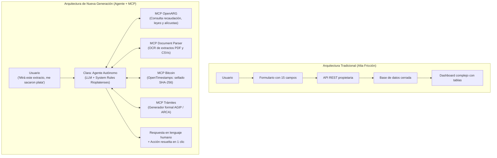

# Arquitectura de Nueva Generación: Agente Autónomo nativo en MCP
**Hackathon EDU HU₿ · LABITCONF 2026**  
**Equipo:** Australianos (Mesa 5 · Hash: `0x0e652757`)  
**Fecha:** Viernes 30 de Octubre · 16:20 hs  

---

## 💡 El Cambio de Paradigma: Del "Software con Menús" al "Agente Conversacional MCP"

El feedback de los mentores apunta directo al corazón de la tendencia tecnológica actual:
> *"Hoy por hoy, más que una app tradicional con menús, formularios y botones complejos, para sacarle toda la fricción al usuario hay que usar un **Agente con lenguaje natural (ida y vuelta cómodo)**. Estamos a la vuelta de la esquina de que no se usen más APIs rígidas y **todo sea MCP (Model Context Protocol)**. Lo potente son las capacidades autónomas que el agente ya entiende."*

### La Paradoja de las Apps Contables Actuales:
En Argentina, el **90% de los freelancers no entra a un portal web ni usa un ERP**: le manda audios o capturas de pantalla de WhatsApp a su contador un domingo a la noche diciendo: *"Che, me entró un cobro y me sacaron 40 lucas, ¿qué es esto?"*.

Obligar al usuario a navegar una web con 6 solapas, menús desplegables y tablas es **generar fricción burocrática**. El verdadero salto cuántico es un **Agente Tributario Autónomo** con el que interactuás por lenguaje natural y que opera mediante **herramientas MCP**.

---

## 🏗️ Comparativa de Arquitectura: Tradicional vs. Agente MCP

---

## 🛠️ El Ecosistema de Herramientas MCP que usa el Agente

En vez de programar integraciones rígidas con endpoints que se rompen cada vez que cambia una norma, el agente invoca **servidores MCP estándar**:

| Herramienta MCP | Servidor MCP | Qué hace de forma autónoma |
| :--- | :--- | :--- |
| **`consultar_normativa_y_padron`** | `openarg-mcp` | Consulta las tablas oficiales de OpenARG (`raw.caba__recaudacion_impositiva__a423bf53__v3`, padrones de riesgo fiscal de AGIP y artículos del Código Fiscal). |
| **`analizar_extracto_bancario`** | `document-parser-mcp` | Lee el PDF o CSV del banco del usuario, detecta líneas con retenciones (`SIRCREB`, `IIBB`, `AGIP`) y calcula el total retenido. |
| **`verificar_situacion_fiscal`** | `arca-rules-mcp` | Cruza la condición del usuario (Monotributo cat. C, Factura E exportador) contra la exención legal (Art. 179 inc. 21). |
| **`sellar_en_bitcoin`** | `opentimestamps-mcp` | Calcula la huella SHA-256 del reclamo formal y la ancla en la blockchain de Bitcoin para darle fecha cierta inmutable. |
| **`generar_nota_agip`** | `form-generator-mcp` | Redacta la nota formal de exclusión de padrón y devolución de saldos a favor con formato administrativo oficial. |

---

## 💬 El Diálogo Real: Cómo es la Experiencia del Usuario (Sin Menús)

### Paso 1: El usuario habla con el agente
> **Usuario:** *"Hola Clara, cobro afuera en dólares y me pasé pesos al banco Galicia. Me entraron $500.000 pero me acreditaron $475.000. Te paso el extracto en PDF."*  
> *(Adjunta archivo `extracto-octubre.pdf`)*

### Paso 2: El Agente razona y usa herramientas MCP
1. Invoca `analizar_extracto_bancario`:
   - Detecta: `RETENCION IIBB SIRCREB CABA: $25.000` (Alícuota 5%).
2. Invoca `consultar_normativa_y_padron` en `openarg-mcp`:
   - Confirma: Actividad de diseño/software exportado al exterior está exenta bajo el **Art. 179 inc. 21 del Código Fiscal de CABA**.
3. Razona el diagnóstico.

### Paso 3: El Agente responde en lenguaje natural rioplatense
> **Clara (Agente):**  
> *"Revisé tu extracto de Galicia. El banco te aplicó una retención de **$25.000 por SIRCREB** con alícuota del 5%.  
> 
> Como tus cobros son por exportación de servicios (factura E), en CABA estás **100% exenta por ley** (Art. 179 inc. 21 del Código Fiscal). Esa plata no te la debieron haber sacado.  
> 
> Te armé el escrito formal para presentar ante AGIP para que te saquen del padrón el mes que viene y puedas pedir la devolución de lo que te cobraron. Además, sellé la huella del trámite en Bitcoin con OpenTimestamps para que tengas fecha cierta digital indiscutible.  
> 
> ¿Querés descargarte la nota lista para subir a la web de AGIP?"*

### Paso 4: Cierre con 1 clic
> **Usuario:** *"Sí, por favor."*  
> **Clara:** *"Acá tenés el PDF del reclamo y la constancia de sello en Bitcoin. Si en algún momento el trámite se vuelve complejo o AGIP pide inspección presencial, te derivo con un solo toque a un contador matriculado de nuestra red."*

---

## 🚀 Por qué esto deja al Jurado sin Palabras en el Pitch

1. **Cero curva de aprendizaje:** El jurado ve un chat fluido (como WhatsApp) que resuelve un problema hipercomplejo sin que el usuario tenga que aprender a usar un software nuevo.
2. **Alineación con el futuro de la IA (MCP-first):** Demuestra que el equipo no está construyendo software del 2021 (formularios y CRUDs), sino software del 2026 (arquitectura de agentes autónomos que interoperan con datos públicos mediante el estándar abierto MCP).
3. **Resuelve el dolor del "sedentarismo cognitivo" (Bilinkis):** El agente no es una caja negra: le explica al usuario la ley, lo educa sobre sus derechos fiscales y le entrega el control.
