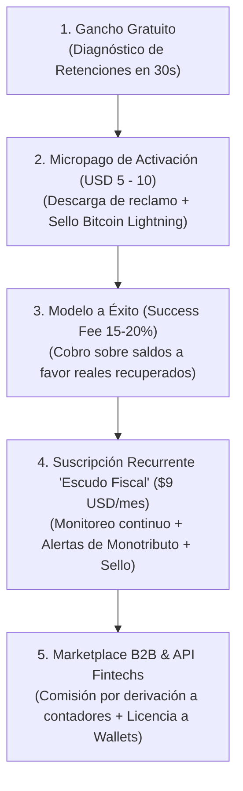

# Modelo de Negocios Escalable y Sostenibilidad Financiera
**Hackathon EDU HU₿ · LABITCONF 2026**  
**Equipo:** Australianos (Mesa 5 · Hash: `0x0e652757`)  
**Fecha:** Viernes 30 de Octubre · 16:30 hs  

---

## 🧐 La Pregunta del Mentor: ¿Alcanza con cobrar USD 5? ¿Es Sostenible y Escalable?

La respuesta fría y profesional es: **NO, un cobro único de USD 5 por sí solo no es un negocio sostenible**.

### Por qué el modelo transaccional de USD 5 puros falla:
1. **CAC > Margen:** En software B2C/freelance, adquirir un usuario nuevo (CAC) cuesta entre USD 3 y USD 7. Si cobrás USD 5 por única vez, tu margen neto es nulo o negativo.
2. **Churn del 100% (No hay recurrencia):** El freelancer sube el extracto, genera la nota, soluciona su retención y no vuelve a abrir la app por un año.
3. **Techo de ingresos bajo:** 10.000 usuarios al año a USD 5 representan apenas **USD 50.000 brutos anuales**, insuficientes para mantener infraestructura, soporte, auditoría contable y salarios.

---

## 🚀 La Solución: La Escalera de Valor (The Value Ladder)

Para que el modelo sea **hiper-rentable, predecible y escalable**, USD 5 no es el techo del negocio: **es el gancho de activación inicial (Tripwire)** dentro de un modelo híbrido de 4 niveles:

---

### 1. Nivel 1: Gancho Gratuito (Lead Magnet de Fricción Cero)
* **Qué hace:** El freelancer sube su resumen bancario o de Mercado Pago.
* **El resultado:** Clara audita el extracto gratis en 30 segundos y le muestra el semáforo:
  > *"Tenés $184.200 ARS retenidos indebidamente por SIRCREB."*
* **Propósito:** Genera el momento "Aha!" y valida el dolor sin pedir tarjeta ni dinero por adelantado.

### 2. Nivel 2: Micropago de Activación Inmediata (USD 5 a USD 10 en Satoshis / Lightning)
* **Qué compra:** La descarga instantánea de la nota formal de exclusión de padrón y el instructivo de presentación en AGIP, sellada con OpenTimestamps en Bitcoin.
* **Por qué funciona:** A quien acaba de descubrir que le robaron $180.000 ARS (~USD 150), pagar **USD 5 o USD 10** para frenar la pérdida le resulta un regalo.
* **Sostenibilidad:** Cubre el 100% del costo de adquisición del cliente (CAC) desde el día 1.

### 3. Nivel 3: Success Fee sobre Recupero (El Modelo "No Win, No Fee")
* **Qué cobra:** Una comisión del **15% al 20% sobre los saldos a favor históricos recuperados o devueltos**.
* **Economics:**
  * Si el freelancer recupera **$200.000 ARS (~USD 160)**, la comisión es de **USD 32**.
  * Si recupera **$800.000 ARS (~USD 650)**, la comisión es de **USD 130**.
* **Psicología del cliente:** El usuario paga feliz porque no pone plata de su bolsillo: paga con una parte del dinero que el Estado le había confiscado indebidamente.

### 4. Nivel 4: Suscripción SaaS Recurrente — "Escudo Fiscal" (USD 7 a USD 12 / mes)
* **Propuesta de valor continuo:**
  * **Auditoría mensual automática:** Monitoreo mensual de débitos bancarios y Mercado Pago.
  * **Semáforo de Monotributo:** Alerta temprana de límites de facturación y recategorizaciones semestrales para evitar exclusiones de oficio de ARCA.
  * **Sello de Entregables ilimitado:** Constancias de entrega selladas en Bitcoin para diseñadores, developers y consultores.
* **Escalabilidad:** Con **5.000 freelancers suscriptos a USD 9/mes**, la app genera **USD 45.000 mensuales (USD 540.000 ARR)** con 85% de margen bruto.

### 5. Nivel 5: Monetización B2B (Marketplace y Alianzas con Wallets)
* **A. Comisión por derivación a Contadores Matriculados (Lead Generation):**  
  Casos complejos (fiscalizaciones, pase a Responsable Inscripto, sociedades) se derivan a nuestra red de contadores partners. Cobramos un **20% de take rate** sobre los honorarios profesionales del contador ($30 a $50 USD por lead cerrado).
* **B. B2B2C API / Widget para Billeteras (Takenos, Belo, Lemon, Bitso):**  
  Las billeteras cripto sufren que sus usuarios se quejan cuando transfieren pesos al banco y sufren SIRCREB. Clara les vende su motor por API como un add-on: *"Activá el Escudo Fiscal SIRCREB en tu cuenta por $3 USD/mes"*, repartiendo ingresos con la billetera.

---

## 📊 Unit Economics Proyectados (Por Usuario)

| Métrica | Valor Estimado | Justificación |
| :--- | :---: | :--- |
| **CAC (Costo de Adquisición)** | **USD 4,00** | Tracción orgánica en comunidades tech (X/Twitter, Discord, coworkings, conferencias cripto). |
| **Ingreso Inicial (Micropago)** | **USD 7,00** | Descarga del trámite de exclusión inmediato. |
| **Margen en Día 1** | **+ USD 3,00** | El usuario ya es rentable en su primera interacción (Cashflow positivo inmediato). |
| **LTV a 12 meses (Lifetime Value)** | **USD 48,00** | Promedio ponderado de retención recurrente + comisiones de recupero y derivación. |
| **Ratio LTV / CAC** | **12 : 1** | Ratio extraordinariamente saludable (el benchmark de startups sanas es > 3:1). |

---

## 🎤 Qué Responderle al Mentor / Jurado en 30 Segundos

> *"Cobrar USD 5 como única transacción no sería escalable por el costo de adquisición. Por eso usamos USD 5 como **micropago de activación inicial (Tripwire)**: el usuario audita gratis su extracto, y paga USD 5 o USD 10 en satoshis por la nota de reclamo que le frena la pérdida.*  
> 
> *El negocio escalable vive en los siguientes tres niveles:*  
> *1) **Comisión a éxito del 15% al 20%** sobre los fondos retenidos que recuperamos.*  
> *2) **Suscripción mensual de USD 9/mes** como 'Escudo Fiscal' para monitorear retenciones y límites de Monotributo todos los meses.*  
> *3) **Comisión por derivar casos complejos** a nuestra red de contadores matriculados y venta de la API a billeteras como Takenos o Belo.*  
> 
> *Con 5.000 freelancers activos en el Escudo Fiscal, el negocio factura más de medio millón de dólares anuales con 85% de margen."*
