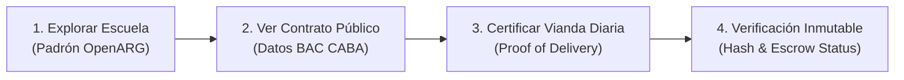

# Bloque 4: El Prototipo (Demo de un Solo Camino)
**Hackathon EDU HU₿ · LABITCONF 2026**  
**Equipo:** Australianos (Mesa 5 · Hash: `0x0e652757`)  
**Horario:** Vie 16:30 a 19:00 · Sáb 9:45 a 12:00  
**Meta:** Construir una demo funcional en lo esencial que cualquier persona pueda probar sin explicaciones.

---

## 1. El Único Recorrido de la Demo (User Journey)

Para no dispersar esfuerzos en 24 horas, definimos **un solo camino de punta a punta**:

1. **Paso 1 (Contexto & Datos Reales):**  
   El usuario entra a la webapp y busca una escuela pública real en zona vulnerable (ej. Escuela N° 12 D.E. 19 de Villa Soldati / Comuna 8, o Escuela N° 11 de La Boca). Datos tomados del **Padrón Oficial de Establecimientos**.
2. **Paso 2 (Contrato y Menú Oficial):**  
   Se muestra el contrato de suministro de alimentos de esa escuela obtenido de **BAC (Buenos Aires Compras)**: proveedor adjudicado, valor unitario licitado por ración y menú estipulado para el día.
3. **Paso 3 (La Acción del Usuario - Certificación):**  
   La docente o miembro de la cooperadora hace el check-in diario de la comida:
   - ¿Llegó a tiempo? (Sí / No)
   - ¿Cantidad de raciones recibidas vs. pedidas? (ej. 180 pedidas, 140 entregadas).
   - Estado de la comida (Caliente / Fría / Fruta en mal estado).
   - Subida de foto testimonial.
4. **Paso 4 (Impacto & Inmutabilidad):**  
   Al enviar, se genera una certificación digital inmutable con hash criptográfico (`Proof of Meal Delivery`). El semáforo de la escuela se actualiza en el mapa público y se dispara la alerta de penalidad contractual sobre el contrato público.

---

## 2. Qué Funciona de Verdad vs. Qué se Simula

| Módulo | Estado en la Demo | Justificación para el Pitch |
| :--- | :---: | :--- |
| **Búsqueda de escuelas y ubicación** | **100% Real** | Datos reales del Padrón Oficial de Establecimientos Educativos de Argentina. |
| **Visualización de contratos de viandas** | **100% Real** | Contratos de BAC (Buenos Aires Compras) en estándar OCDS indexados en OpenARG. |
| **Cálculo de vulnerabilidad de la zona** | **100% Real** | Métricas de pobreza e indigencia por comuna/aglomerado del INDEC. |
| **Formulario de certificación y subida de foto** | **100% Real** | Funciona interactivo en el navegador de punta a punta. |
| **Sellado de Hash / Escrow en Blockchain** | **Simulado / Testnet** | Se calcula el hash SHA-256 del reporte y se muestra en pantalla el estado del contrato (para no depender de tiempos de minado en la demo en vivo). |

---

## 3. Reparto de Roles en Australianos (Mesa 5)

* **Constructor / Frontend Dev:** Construye la interfaz web interactiva (Next.js / React / Vite + Tailwind). Simple, responsive y visual.
* **Datos & Backend / Integración OpenARG:** Extrae y prepara los datasets de escuelas, contratos BAC e indicadores INDEC; implementa el motor de búsqueda y verificación.
* **Diseñador / UX & Contenido:** Diseña el flujo visual, prepara las pantallas claras, el logo/branding de *Plato Abierto* y el material gráfico.
* **Pitch Master & Validación:** Lidera las entrevistas del Bloque 2 y Bloque 5, redacta el guión de 60 segundos y ensaya con el cronómetro.

---

## 4. Tarea Clave del Sábado a la Mañana (09:45)
* [ ] Integrar el front con los datos fijos cargados en JSON/API.
* [ ] Hacer deploy público en Vercel/Netlify con URL accesible desde celular o laptop para el jurado.
* [ ] Grabar el video de respaldo de 20-30 segundos por si se cae el wifi de Costa Salguero en el pitch.

---

## 5. Criterio de "Bloque Minado"
- [ ] Recorrido único definido.
- [ ] Roles asignados.
- [ ] Demo funcional en vivo (abrible mediante link).
